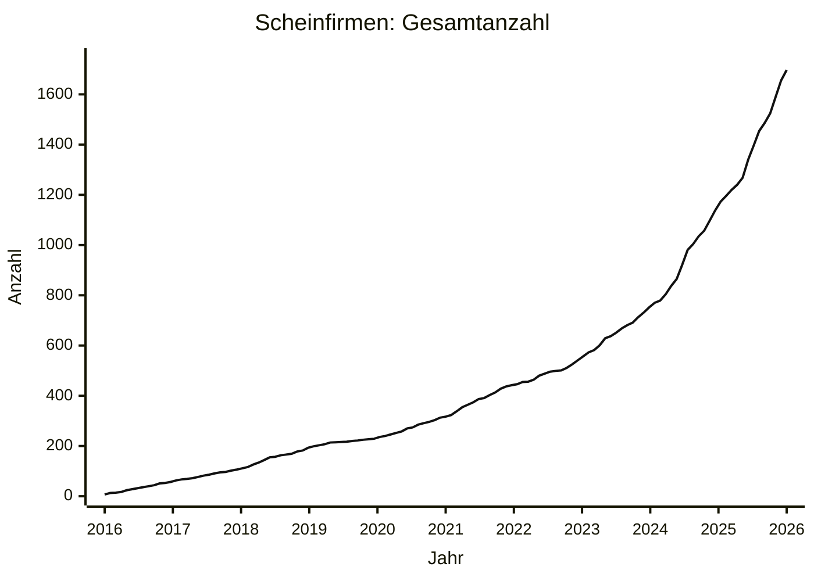

# Scheinfirmen Österreich — Statistik

| Stand | Gesamt | Erster Eintrag |
|-------|-------:|----------------|
| 2026-10-30T09:33:21 | 1697 | 2016-04-01 |

## Verlauf

## Neueste Scheinfirmen (letzte 30 Tage)

| Name | UID | Anschrift |
|------|-----|-----------|
| A4 Energy GmbH | ATU78633926 | 1160 Wien, Hasnerstraße 82 |
| ABEVA Handels GmbH | ATU81356523 | 1100 Wien, Hauffgasse 17 |
| ACS Gyula |  | 7503 Großpetersdorf, Raiffeisenplatz 1 |
| ADIPALLY Saikrishna | ATU81206106 | 1110 Wien, Geiselbergstraße 34-36 |
| ALDEMIROV Sider |  | 1200 Wien, Greiseneckergasse 6 |
| ANINI Projektentwicklungs GmbH | ATU71400548 | 1160 Wien, Koppstraße 43/6 |
| BABIC Petar | ATU83092546 | 1140 Wien, Ameisgasse 36 |
| BOLLA Lilla | ATU68313611 | 7471 Rechnitz, Herrengasse 24 |
| CHITHIRANANDAN Asviin |  | 1110 Wien, Miltnerweg 23/16/20 |
| Dr. HEGEDÜS György |  | 7503 Großpetersdorf, Raiffeisenplatz 1/3 |
| FEHER Handels GmbH in Liquidation | ATU69539948 | 1010 Wien, Ebendorferstraße 10/8 |
| GEOMASTER Bohrtechnik GmbH | ATU78577835 | 7000 Eisenstadt, Mattersburger Straße 26/1 |
| GRG Garage GmbH | ATU79238978 | 1100 Wien, Laxenburger Straße 32 |
| HATTAB GmbH | ATU76839236 | 1170 Wien, Gschwandnergasse 37 |
| ILIEV David |  | 1160 Wien, Hasnerstraße 82 |
| ILIEV Sasho | ATU82826328 | 1100 Wien, Erlachgasse 137 |
| IRFAQ Abdul | ATU74140404 | 1210 Wien, Kahlgasse 3 |
| Klick Montage GmbH | ATU68361701 | 1230 Wien, Ketzergasse 65 |
| LADIC Albert | ATU82656207 | 1200 Wien, Treustraße 34 |
| LAZAR Zsolt | ATU82801746 | 1100 Wien, Knöllgasse 26 |
| LIV Living Concepts GmbH |  | 9500 Villach, Kärntner Straße 8 |
| Lamberts Holding GmbH |  | 1170 Wien, Schulthessgasse 3 |
| MEZEI Nikolett |  | 7503 Großpetersdorf, Raiffeisenplatz 1/3 |
| NAGY Gabriella | ATU79452003 | 7503 Großpetersdorf, Raiffeisenplatz 1 |
| NEMETH Levente Gabor | ATU82789939 | 1100 Wien, Rieplstraße 8 |
| PAMIDALA Venkata Sai Teja | ATU82680537 | 1100 Wien, Jagdgasse 36 |
| PETROVS Vitalijs | ATU83199548 | 1100 Wien, Fernkorngasse 36 |
| PREDESCU Ionut-Lucian | ATU81508469 | 6020 Innsbruck, Dr.-Stumpf-Straße 57 |
| Project RK GmbH | ATU75880067 | 1210 Wien, Schillgasse 16 |
| R & R Consulting GmbH | ATU67330747 | 2500 Baden, Mühlgasse 2-4 |
| SAMT e.U. | ATU81730548 | 1220 Wien, Haberergasse 5/6 |
| SZARVAS Jozef |  | 7503 Großpetersdorf, Raiffeisenplatz 1 |
| SZATMARI Tamas | ATU79880112 | 7503 Großpetersdorf, Raiffeisenplatz 1/3 |
| SZEKERES Istvan | ATU79297814 | 7503 Großpetersdorf, Raiffeisenplatz 1 |
| SZILAGYI Maria Magdolna | ATU83215637 | 1100 Wien, Leebgasse 45/1C |
| VAGI Sandor Zsolt | ATU79760279 | 7503 Großpetersdorf, Raiffeisenplatz 1 |
| VARSANYI Zsolt | ATU78982905 | 7503 Großpetersdorf, Raiffeisenplatz 1/3 |
| VASILE Ioan-Eugen | ATU81264819 | 1160 Wien, Lerchenfelder Gürtel 33 |
| VITTMAYER Peter |  | 7503 Großpetersdorf, Raiffeisenplatz 1 |
| WATOR Tamas |  | 7503 Großpetersdorf, Raiffeisenplatz 1 |
| Wallhof Bau GmbH | ATU77711424 | 1160 Wien, Nauseagasse 25 |