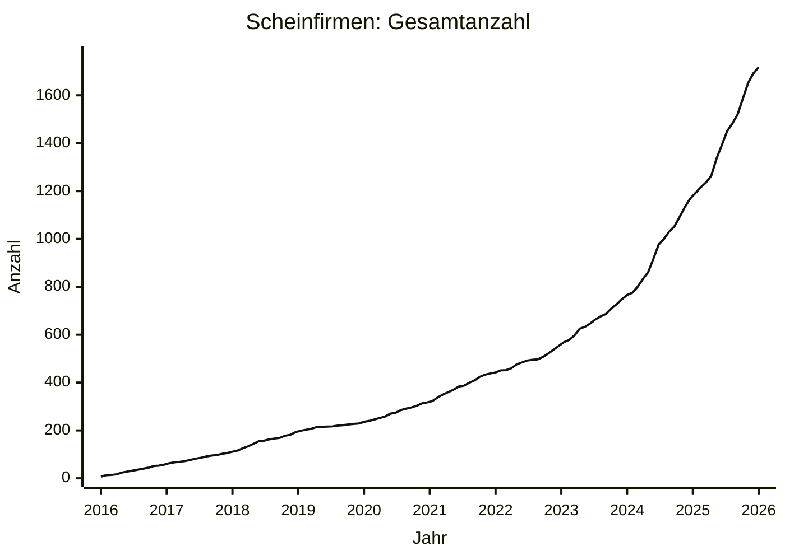

# Scheinfirmen Österreich — Statistik

| Stand | Gesamt | Erster Eintrag |
|-------|-------:|----------------|
| 2026-11-19T11:14:34 | 1717 | 2016-04-01 |

## Verlauf

## Neueste Scheinfirmen (letzte 30 Tage)

| Name | UID | Anschrift |
|------|-----|-----------|
| ABEVA Handels GmbH | ATU81356523 | 1100 Wien, Hauffgasse 17 |
| AMELIS Bau GmbH | ATU68542918 | 1150 Wien, Stutterheimstraße 16-18 |
| All-in Trockenbau GmbH | ATU74567426 | 1010 Wien, Kohlmarkt 8-10 |
| BABIC Petar | ATU83092546 | 1140 Wien, Ameisgasse 36 |
| BAKRO Bertalan | ATU82731947 | 1160 Wien, Hasnerstraße 82/6 |
| Bauer Consulting GmbH | ATU65643716 | 8731 Gaal, Puchschachen 50 |
| Blue Gebäudeservice KG | ATU82695512 | 6020 Innsbruck, Fürstenweg 56 |
| DDS TOP KG | ATU80312109 | 1200 Wien, Klosterneuburger Straße 8 |
| Elektro ELLA GmbH | ATU78200313 | 1140 Wien, Ameisgasse 36 |
| FourSense GmbH | ATU67925025 | 1010 Wien, Sterngasse 3 |
| GOSHEVA Vaska | ATU81379526 | 1160 Wien, Gablenzgasse 34 |
| Geani GmbH | ATU83019323 | 1230 Wien, Lastenstraße 23/3/3 |
| Gebr. SÜZGEN Bau GmbH | ATU81615414 | 1100 Wien, Maria-Rekker-Gasse 1 |
| HORI GmbH | ATU78042958 | 1100 Wien, Schröttergasse 29 |
| JAMBOR Gabor | ATU79403316 | 7503 Großpetersdorf, Raiffeisenplatz 1 |
| KESIREDDY Srikanth Reddy | ATU82270249 | 1140 Wien, Hütteldorfer Straße 181 |
| Kulov GmbH | ATU75629205 | 9020 Klagenfurt/Wörthersee, Pischeldorfer Straße 270 |
| LADIC Albert | ATU82656207 | 1200 Wien, Treustraße 34 |
| LAYA Lerchenfeldergürtel 55A Pro GmbH | ATU72368047 | 1160 Wien, Gablenzgasse 14 |
| LIV Living Concepts GmbH |  | 9500 Villach, Kärntner Straße 8 |
| Lamberts Holding GmbH |  | 1170 Wien, Schulthessgasse 3 |
| MORAVEC Bau GmbH | ATU74596546 | 1230 Wien, Slamastraße 43/3A |
| MYT GmbH | ATU82959657 | 1210 Wien, Hofherr-Schrantz-Gasse 2 |
| NEMETH Levente Gabor | ATU82789939 | 1100 Wien, Rieplstraße 8 |
| PAMIDALA Venkata Sai Teja | ATU82680537 | 1100 Wien, Jagdgasse 36 |
| PETROVS Vitalijs | ATU83199548 | 1100 Wien, Fernkorngasse 36 |
| PREDESCU Ionut-Lucian | ATU81508469 | 6020 Innsbruck, Dr.-Stumpf-Straße 57 |
| Pflasterprinz GmbH | ATU82727024 | 1100 Wien, Absberggasse 29/1/39 |
| Power Clean KFZ GmbH | ATU82147614 | 5071 Wals-Siezenheim, Dr.-Hans-Lechner-Straße 6 |
| Prog Up GmbH | ATU80501645 | 1220 Wien, Schillingstraße 14A |
| Project RK GmbH | ATU75880067 | 1210 Wien, Schillgasse 16 |
| SABAU Elisaveta-Georgeta | ATU80258524 | 6020 Innsbruck, Dr.-Stumpf-Straße 57/3 |
| SAMT e.U. | ATU81730548 | 1220 Wien, Haberergasse 5/6 |
| TCI Technical Center for Innovations GmbH | ATU72598824 | 1160 Wien, Hasnerstraße 82 |
| VAJDA Krisztian | ATU82943148 | 1140 Wien, Dreyhausenstraße 5/15a |
| VANAMALA Rashmitha | ATU82172346 | 1160 Wien, Herbststraße 47 |